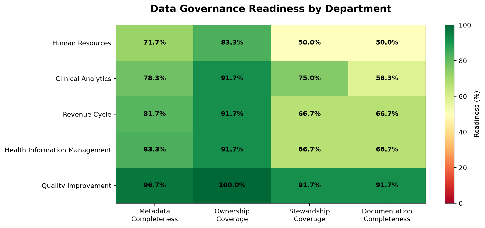

# cintel-03-signal-design-sowers

[](pyproject.toml)
[](https://github.com/ssowers2/cintel-03-signal-design-sowers/actions/workflows/ci-python-zensical.yml)
[](https://ssowers2.github.io/cintel-03-signal-design-sowers/)

[](https://docs.astral.sh/uv/)
[](https://docs.astral.sh/ty/)
[](https://zensical.org/)
[](LICENSE)

> Transform raw data into meaningful monitoring signals to support data governance and informed decision-making.

## Project Overview

**Author:** Sabriya Sowers
**Date:** November 2026

This project explores signal design for continuous intelligence using Python and Polars.

The goal is to transform raw measurements into meaningful indicators that help identify patterns, monitor performance, and support decision-making.

The instructor's example focuses on system reliability using request volumes, errors, and response times. For my D2 technical modification, I extended the example by adding a success-rate signal.

For my D3 custom application, I developed a **Metadata Completeness & Governance Readiness Monitor** using synthetic metadata from a fictional healthcare organization.

The custom project analyzes 60 data assets across five departments and calculates four Data Governance signals:

- **Metadata completeness:** Percentage of required metadata fields documented.
- **Ownership coverage:** Percentage of assets with an assigned data owner.
- **Stewardship coverage:** Percentage of assets with an assigned data steward.
- **Documentation gaps:** Percentage of assets missing a description, business definition, or both.

The results are summarized by department and visualized in a governance readiness heatmap to identify opportunities for improving metadata documentation and stewardship practices.

All custom data is synthetic. No real patient information, employee records, or protected health information (PHI) were used.

The project is configured in [pyproject.toml](pyproject.toml).

## Data

### Instructor Example

The instructor's example uses 10 system performance observations from `data/system_metrics.csv`.

Each observation includes:

- `requests` - number of requests handled.
- `errors` - number of failed requests.
- `total_latency_ms` - cumulative response time in milliseconds.

### Custom Healthcare Metadata Dataset

For D3, I created a synthetic healthcare metadata inventory containing 60 fictional data assets across five departments:

- Clinical Analytics
- Revenue Cycle
- Quality Improvement
- Health Information Management
- Human Resources

Each asset includes eight fields: asset ID, dataset name, department, data owner, data steward, description, business definition, and data classification.

The dataset uses simplified status values such as `Assigned`, `Complete`, and `Missing` to represent metadata availability.

All records are synthetic and were created for this educational project.

**Dataset:** [View Synthetic Metadata Inventory](data/metadata_inventory.csv)

**Data Card:** [View Dataset Documentation](data/data-card.md)

**Heatmap:** [View Governance Readiness Heatmap](artifacts/governance_readiness_heatmap.png)

## Approach

### Instructor Example

The instructor's example uses Python and Polars to calculate three system performance signals:

- **Error rate:** Proportion of failed requests.
- **Average latency:** Average response time per request.
- **Throughput:** Number of requests per observation.

For D2, I extended the example by adding a **success-rate signal** to measure the proportion of successful requests.

### Custom Data Governance Signals

For D3, I adapted the same signal design techniques to analyze healthcare metadata using four measurements:

1. **Metadata completeness:** Proportion of five required metadata fields documented for each asset.
2. **Ownership coverage:** Whether each asset has an assigned data owner.
3. **Stewardship coverage:** Whether each asset has an assigned data steward.
4. **Documentation gaps:** Whether an asset is missing a description, business definition, or both.

I used reusable Python functions to calculate these signals, aggregated the results by department using Polars, and created a governance readiness heatmap using Matplotlib.

### Project Components

- [Governance Signal Calculations](src/cintel/utils_governance.py)
- [Governance Pipeline](src/cintel/governance_pipeline.py)
- [Governance Visualization](src/cintel/governance_visualization.py)
- [Synthetic Metadata Dataset](data/metadata_inventory.csv)
- [Data Card](data/data-card.md)
- [Generated Results](artifacts/)
- [Full Project Documentation](https://ssowers2.github.io/cintel-03-signal-design-sowers/)

## Run the Project

This project includes the instructor's system performance example and a custom healthcare Data Governance application.

Run the following commands from the project root in a VS Code terminal.

### 1. Run the Instructor Example

```powershell
uv run python -m cintel.signal_design
```

This generates `artifacts/signals.csv`, including the D2 success-rate modification.

### 2. Run the Data Governance Pipeline

```powershell
uv run python -m cintel.governance_pipeline
```

This processes the synthetic healthcare metadata inventory and generates:

- `artifacts/governance_signals.csv` - asset-level governance signals.
- `artifacts/governance_department_summary.csv` - departmental governance measurements.

### 3. Generate the Governance Readiness Heatmap

```powershell
uv run python -m cintel.governance_visualization
```

This creates `artifacts/governance_readiness_heatmap.png`, which visualizes metadata completeness, ownership coverage, stewardship coverage, and documentation completeness across five departments.

## Run the Reactive App

From a VS Code terminal in the project root (press CTRL + C to quit):

```shell
uv run marimo run src/cintel/app.py
```

## Results

### Instructor Example and D2 Results

The instructor's example processes 10 system performance observations and generates calculated monitoring signals in `artifacts/signals.csv`.

For D2, I added a success-rate signal. The calculated success rates ranged from 97.5% to 100%, demonstrating the relationship between successful requests and system reliability.

### D3: Healthcare Metadata Governance Results

The custom Data Governance pipeline analyzed 60 synthetic healthcare data assets across five fictional departments.

#### Organization-Wide Findings

- **Ownership coverage:** 91.67% (55 of 60 assets)
- **Stewardship coverage:** 70.00% (42 of 60 assets)
- **Documentation gap rate:** 33.33% (20 of 60 assets)

These measurements indicate that stewardship assignments and metadata documentation present greater improvement opportunities than ownership assignments in this fictional organization.

#### Departmental Governance Results

| Department | Metadata Completeness | Ownership Coverage | Stewardship Coverage | Documentation Gap |
|---|---:|---:|---:|---:|
| Human Resources | 71.67% | 83.33% | 50.00% | 50.00% |
| Clinical Analytics | 78.33% | 91.67% | 75.00% | 41.67% |
| Revenue Cycle | 81.67% | 91.67% | 66.67% | 33.33% |
| Health Information Management | 83.33% | 91.67% | 66.67% | 33.33% |
| Quality Improvement | 96.67% | 100.00% | 91.67% | 8.33% |

#### Governance Readiness Heatmap

The heatmap compares metadata completeness, ownership coverage, stewardship coverage, and documentation completeness across the five departments.



Higher percentages represent stronger governance coverage or completeness. Documentation completeness is calculated as 100% minus the documentation gap percentage.

#### Key Findings

**Human Resources:** Demonstrated the greatest improvement opportunity, with 71.67% metadata completeness, 50.00% stewardship coverage, and documentation gaps affecting half of its assets.

**Clinical Analytics:** Demonstrated strong ownership coverage (91.67%) but had documentation gaps affecting 41.67% of its assets.

**Quality Improvement:** Demonstrated the strongest overall governance measurements, including 96.67% metadata completeness and 100% ownership coverage.

These findings demonstrate how Data Governance signals can help prioritize stewardship conversations, identify documentation gaps, and support informed decisions.

All results are based on synthetic data and do not represent actual healthcare organizational performance.

#### Generated Artifacts

- [Asset-Level Governance Signals](artifacts/governance_signals.csv)
- [Departmental Governance Summary](artifacts/governance_department_summary.csv)
- [Governance Readiness Heatmap](artifacts/governance_readiness_heatmap.png)
- [Synthetic Metadata Inventory](data/metadata_inventory.csv)
- [Dataset Data Card](data/data-card.md)
- [Full Project Documentation](https://ssowers2.github.io/cintel-03-signal-design-sowers/)

## Verification

Run the automated tests:

```shell
uv run pytest
```

The automated tests passed with 27.27% overall coverage, exceeding the project's 20% minimum coverage requirement.

The documentation website was successfully built using `uv run zensical build`, with no issues reported.

The custom governance pipeline and visualization were executed successfully, generating the asset-level signals, departmental summary, and governance readiness heatmap.

## Project Documentation

The [hosted documentation site](https://ssowers2.github.io/cintel-03-signal-design-sowers/) is published using Zensical and GitHub Pages.

The documentation site presents the project report, including:

- Data and operational questions.
- Signal calculations and methods.
- Technical modifications.
- Results and visualizations.
- Interpretation and limitations.
- Conclusions.

## CI/CD and GitHub Actions

This project includes continuous integration and continuous deployment (CI/CD) workflows to check project files and publish documentation.

GitHub Actions include:

- [CI: Python and Documentation Checks](https://github.com/ssowers2/cintel-03-signal-design-sowers/actions/workflows/ci-python-zensical.yml)
- [CD: Documentation Deployment](https://github.com/ssowers2/cintel-03-signal-design-sowers/actions/workflows/deploy-zensical.yml)

## Developer Reference

Follow the [Professional Python Workflow Guide](https://denisecase.github.io/pro-analytics-02/) for detailed instructions and troubleshooting.

### Initialize and Update the Python Environment

With the project open in VS Code, open a terminal and run:

```shell
uvx pup-clean --delete
uv self update
uv python pin 3.14
uv python install
uv lock --upgrade
uv sync
uv audit
```

### Set Up and Run Git Hooks

Set up and run the Git hooks to perform basic checks automatically before changes are pushed to GitHub.

```shell
uvx prek install --force
uvx prek update --freeze --cooldown-days 7

git add -A
uvx prek run --all-files
# Repeat if changes were made
uvx prek run --all-files
```

### Run Common Chores

Run linters, formatters, type checks, tests, and build the documentation.

```shell
uv run ruff check . --fix
uv run ruff format .

uv run ty check
uv run python -m pytest
uv run python -m zensical build
```

### Git Add-Commit-Push to GitHub

After making useful changes, save your work to GitHub.

```shell
git add -A
git commit -m "describe your changes in quotes"
git push -u origin main
```

## Developer Notes

- Use the **UP ARROW** and **DOWN ARROW** in the terminal to scroll through previous commands.
- Use `CTRL+F` to find and replace text within a file.

## Developer Tools

This project uses professional Python tools to support development, testing, documentation, and code quality.

- [uv](https://docs.astral.sh/uv/) - Python environments and dependencies.
- [Ruff](https://docs.astral.sh/ruff/) - Python linting and formatting, configured in [.ruff.toml](.ruff.toml).
- [ty](https://docs.astral.sh/ty/) - Python type checking.
- [pytest](https://docs.pytest.org/) - automated Python testing, configured in [.pytest.toml](.pytest.toml).
- [prek](https://prek.j178.dev/) - Git hooks and automated checks, configured in [prek.toml](prek.toml).
- [Zensical](https://zensical.org/) - project documentation, configured in [zensical.toml](zensical.toml).

## Links

- [GitHub Repository](https://github.com/ssowers2/cintel-03-signal-design-sowers)
- [Hosted Documentation](https://ssowers2.github.io/cintel-03-signal-design-sowers/)
- [Professional Python Workflow Guide](https://denisecase.github.io/pro-analytics-02/)
- [Citation](CITATION.cff)
- [License](LICENSE)

### Small Technical Modification — Success Rate Signal

For this experiment, I added a new `success_rate` signal to the
original system metrics pipeline using Python and Polars.

**Purpose:** Measure the proportion of requests completed
successfully, providing another way to evaluate system reliability.

**Calculation:**

success_rate = (requests - errors) / requests

The calculation handles zero requests to avoid division-by-zero errors.

**Prediction:** I expected the new signal to show higher success
rates when fewer requests failed.

**Results:** The updated pipeline successfully generated the
`success_rate` column in `artifacts/signals.csv`. Across the 10
records, success rates ranged from 97.5% to 100%.

**What I learned:** Adding a derived signal can provide another
perspective on existing data without changing the original
measurements.
