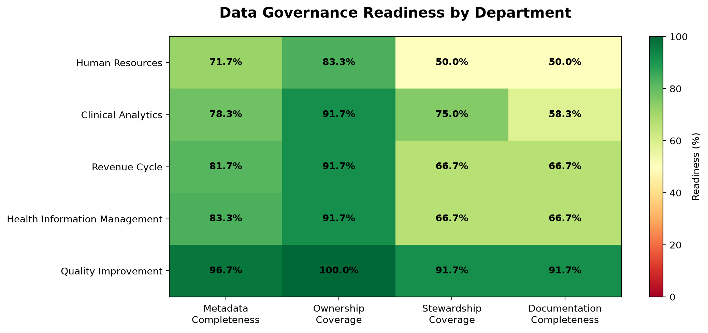

# Metadata Completeness & Governance Readiness Monitor

Continuous Intelligence | Project 03 | Signal Design

**Author:** Sabriya Sowers
**Date:** 2026 November

## Overview

For my custom project, I applied these same techniques to **Data Governance**, focusing on metadata completeness, data ownership, stewardship coverage, and documentation quality.

I developed a **Metadata Completeness & Governance Readiness Monitor** that identifies gaps in metadata documentation and supports data stewardship activities using synthetic healthcare data.

## Data

### Instructor Example Dataset

The example contains 10 observations of system activity.

Each observation includes:

- `requests` - number of requests handled.
- `errors` - number of failed requests.
- `total_latency_ms` - cumulative response time.

[View Example Dataset](https://github.com/ssowers2/cintel-03-signal-design-sowers/blob/main/data/system_metrics.csv)

### Custom Healthcare Metadata Dataset

For my custom application, I created a synthetic healthcare metadata inventory to explore how Data Governance signals can identify documentation and accountability gaps.

The dataset contains 60 fictional data assets distributed evenly across five departments:

- Clinical Analytics
- Revenue Cycle
- Quality Improvement
- Health Information Management
- Human Resources

Each data asset contains eight fields:

- `asset_id` - unique identifier for the data asset.
- `dataset_name` - name of the fictional dataset.
- `department` - department associated with the asset.
- `data_owner` - whether an owner is assigned.
- `data_steward` - whether a steward is assigned.
- `description` - whether a description is documented.
- `business_definition` - whether a business definition is documented.
- `data_classification` - whether a classification is documented.

The dataset uses simplified status values such as `Assigned`, `Complete`, and `Missing` to represent metadata availability.

All records are synthetic and were created for this educational project. No real patient data, employee records, or protected health information (PHI) were used.

**Dataset Documentation:** [View the Synthetic Healthcare Metadata Inventory Data Card](data-card.md)

**Source Data:** [View the Synthetic Metadata Inventory](https://github.com/ssowers2/cintel-03-signal-design-sowers/blob/main/data/metadata_inventory.csv)

## Methods

### Instructor Example Signals

The example pipeline calculates three monitoring signals.

#### Error Rate

Error rate measures the proportion of failed requests.

```python
error_rate = errors / requests
```

#### Average Latency

Average latency estimates response time per request.

```python
avg_latency_ms = total_latency_ms / requests
```

#### Throughput

The example uses the number of requests per observation as its throughput indicator.

```python
throughput = requests
```

The pipeline handles zero-request observations without dividing by zero.

### Part D2: Small Technical Modification — Success Rate

For my small technical experiment, I added a fourth signal,
`success_rate`, to the instructor's original system metrics pipeline.

The purpose was to measure the proportion of successful requests
and provide another perspective on system reliability.

#### Success Rate Calculation

`success_rate = (requests - errors) / requests`

I modified the `design_signals()` function in
`src/cintel/utils_system.py` using Polars and updated the logging
message in `src/cintel/signal_design.py`.

The calculation handles zero-request observations to avoid
division-by-zero errors.

I predicted that records with fewer errors relative to total
requests would have higher success rates.

### Custom Data Governance Signals

For my custom application, I adapted the instructor's signal design approach to measure metadata completeness and governance readiness within a fictional healthcare organization.

Using Python and Polars, I developed four signals that transform metadata status values into measurable indicators.

#### 1. Metadata Completeness

Measures the proportion of five required metadata fields that are documented for each data asset:

- Data owner
- Data steward
- Description
- Business definition
- Data classification

```text
metadata_completeness = completed_required_fields / 5
```

A score of 1.0 represents 100% completeness, while 0.6 represents 60% completeness.

#### 2. Data Ownership Signal

Identifies whether each data asset has an assigned data owner.

```text
owner_assigned = 1 if assigned, otherwise 0
```

A departmental ownership coverage percentage is calculated by averaging this signal across the department's assets and multiplying by 100.

#### 3. Data Stewardship Signal

Identifies whether each data asset has an assigned data steward.

```text
steward_assigned = 1 if assigned, otherwise 0
```

This signal helps identify assets that may lack designated support for metadata management and stewardship activities.

#### 4. Documentation Gap Signal

Identifies whether a data asset is missing a description, a business definition, or both.

```text
documentation_gap = 1 if either field is missing, otherwise 0
```

Unlike the ownership and stewardship signals, a value of 1 indicates a documentation problem.

For visualization purposes, documentation completeness is calculated as:

```text
documentation_completeness = 100 - documentation_gap_percentage
```

This ensures that higher percentages consistently represent stronger governance readiness in the heatmap.

#### Pipeline Implementation

The custom pipeline uses three Python modules:

- `utils_governance.py` - contains reusable signal calculations.
- `governance_pipeline.py` - loads the metadata inventory, calculates signals, and creates CSV outputs.
- `governance_visualization.py` - creates a departmental governance readiness heatmap using Matplotlib.

The pipeline generates two CSV files:

- `artifacts/governance_signals.csv` - individual asset-level signals.
- `artifacts/governance_department_summary.csv` - departmental governance measurements.

The visualization script generates:

- `artifacts/governance_readiness_heatmap.png` - a heatmap comparing governance measurements across five departments.

#### How This Differs from the Instructor Example

The instructor's example measures system performance using request counts, errors, and latency.

My custom application uses synthetic healthcare metadata to measure documentation completeness, accountability assignments, and governance improvement opportunities.

Both applications use Python and Polars to transform raw data into calculated signals, but they address different monitoring questions.

## Results

### Instructor Example Results

The example demonstrates the following observed ranges:

| Signal | Observed Range |
|---|---|
| Error rate | 0% to 2.5% |
| Average latency | 25.0 to 33.71 ms |
| Requests per observation | 60 to 200 |

The output contains the original system measurements alongside the calculated signals.

[View Signal Results Including D2 Modification](https://github.com/ssowers2/cintel-03-signal-design-sowers/blob/main/artifacts/signals.csv)

### Part D2: Success Rate Experiment Results

The updated pipeline successfully processed all 10 system metric
records and generated a new `success_rate` column in
`artifacts/signals.csv`.

The table below shows selected observations from the experiment.

| Requests | Errors | Error Rate | Success Rate |
|---------:|-------:|-----------:|-------------:|
| 120 | 3 | 2.50% | 97.50% |
| 150 | 2 | 1.33% | 98.67% |
| 200 | 5 | 2.50% | 97.50% |
| 60 | 0 | 0.00% | 100.00% |

Across all 10 observations, success rates ranged from
97.5% to 100%.

The results matched my prediction. Records with lower error
rates had higher success rates.

[View Updated Signal Results](https://github.com/ssowers2/cintel-03-signal-design-sowers/blob/main/artifacts/signals.csv)

### Custom Project Results

The custom Data Governance pipeline successfully processed 60 synthetic healthcare data assets across five fictional departments.

The pipeline generated four governance signals and a departmental summary to identify metadata documentation and accountability gaps.

#### Organization-Wide Findings

Across the 60 data assets:

- **Ownership coverage:** 91.67% (55 of 60 assets)
- **Stewardship coverage:** 70.00% (42 of 60 assets)
- **Documentation gap rate:** 33.33% (20 of 60 assets)

These results indicate that stewardship assignments and metadata documentation present greater improvement opportunities than ownership assignments in this fictional organization.

#### Departmental Governance Results

| Department | Metadata Completeness | Ownership Coverage | Stewardship Coverage | Documentation Gap |
|---|---:|---:|---:|---:|
| Human Resources | 71.67% | 83.33% | 50.00% | 50.00% |
| Clinical Analytics | 78.33% | 91.67% | 75.00% | 41.67% |
| Revenue Cycle | 81.67% | 91.67% | 66.67% | 33.33% |
| Health Information Management | 83.33% | 91.67% | 66.67% | 33.33% |
| Quality Improvement | 96.67% | 100.00% | 91.67% | 8.33% |

#### Data Governance Readiness Heatmap

The following heatmap compares governance measurements across the five departments.



The visualization uses documentation completeness rather than documentation gap rate so that higher percentages consistently indicate stronger governance readiness.

Green represents stronger coverage or completeness, while red and yellow highlight potential improvement opportunities.

#### Key Findings

**Human Resources:** Demonstrated the lowest metadata completeness (71.67%) and stewardship coverage (50.00%). Half of its data assets also had documentation gaps, making it the highest-priority department for governance improvement in this synthetic example.

**Clinical Analytics:** Demonstrated strong ownership coverage (91.67%) but had documentation gaps affecting 41.67% of its assets.

**Quality Improvement:** Demonstrated the strongest overall governance measurements, including 96.67% metadata completeness and 100% ownership coverage.

#### Generated Artifacts

- [View Asset-Level Governance Signals](https://github.com/ssowers2/cintel-03-signal-design-sowers/blob/main/artifacts/governance_signals.csv)
- [View Departmental Governance Summary](https://github.com/ssowers2/cintel-03-signal-design-sowers/blob/main/artifacts/governance_department_summary.csv)
- [View Governance Readiness Heatmap](https://github.com/ssowers2/cintel-03-signal-design-sowers/blob/main/artifacts/governance_readiness_heatmap.png)

All findings are based on synthetic data and do not represent actual healthcare organizational performance.

## Interpretation

### Instructor Example

Error rate provides an indicator of system reliability, while average latency describes responsiveness.

Request counts provide additional context about system activity.

Together, these signals provide a more informative view of system behavior than the raw measurements alone.

### Part D2: Experiment Interpretation

This experiment demonstrated how a new signal can be calculated
from existing measurements without modifying the original data.

While error rate measures failed requests, success rate measures
the proportion of requests completed successfully.

I learned how to extend an existing Polars transformation,
update the pipeline output, and verify the calculated results.

The success-rate signal provides an additional perspective on
system reliability, although it is mathematically related to
the existing error-rate signal.

The experiment also reinforced the importance of validating
changes before committing them to GitHub.

### Custom Data Governance Interpretation

The results demonstrate how metadata records can be transformed into actionable Data Governance signals using Python and Polars.

Although the fictional organization has 91.67% ownership coverage, stewardship coverage is only 70.00%. This 21.67-percentage-point difference suggests that assigning data owners does not necessarily mean every asset has a designated steward responsible for supporting ongoing metadata management.

The analysis also identified documentation gaps affecting 33.33% of the organization's data assets. This highlights why measuring ownership alone is insufficient to understand overall governance readiness.

#### Prioritizing Governance Improvements

Human Resources emerged as the department with the greatest improvement opportunity. It had the lowest metadata completeness (71.67%), lowest stewardship coverage (50.00%), and highest documentation gap rate (50.00%).

In a real Data Governance program, these findings could help prioritize stakeholder conversations, clarify stewardship responsibilities, and identify datasets requiring additional documentation.

Rather than introducing new requirements without understanding existing workflows, a governance team could use these measurements to engage departments, understand barriers, and collaboratively address gaps.

#### Lessons Learned

This project demonstrated how to:

- Transform raw metadata statuses into measurable governance signals.
- Use reusable Python functions to calculate multiple indicators.
- Aggregate asset-level measurements into departmental summaries.
- Visualize governance readiness using a heatmap.
- Identify improvement opportunities through data rather than assumptions.

The project also reinforced that governance metrics are most useful when they support informed conversations and practical improvements, rather than simply measuring compliance.

Because the dataset is synthetic, these findings demonstrate the analytical approach rather than actual organizational performance.


## Limitations

The instructor's system performance example does not establish acceptable performance thresholds or evaluate changes over time.

Request counts are not normalized by elapsed time, so they represent throughput only when observation intervals are comparable.

The D2 success-rate signal is derived from the same measurements as error rate. Therefore, it provides an alternative perspective rather than an independent measure of system performance.

### Custom Data Governance Project Limitations

The custom metadata inventory contains synthetic records and does not represent actual healthcare organizational performance.

Several limitations should be considered:

- **Synthetic data:** The results demonstrate the analytical approach rather than actual governance conditions.
- **Simplified metadata:** Status values such as `Assigned`, `Complete`, and `Missing` do not evaluate the accuracy, usefulness, or currency of metadata.
- **Equal department sizes:** Each fictional department contains 12 assets, which may not reflect real organizational distributions.
- **Assignment versus effectiveness:** Having an assigned owner or steward does not guarantee that governance responsibilities are actively performed.
- **Single snapshot:** The dataset represents one point in time and cannot demonstrate improvement or deterioration over time.
- **No validated readiness threshold:** The project does not establish formal organizational standards for acceptable metadata completeness or governance readiness.

The four governance measurements should be interpreted as indicators of potential improvement opportunities, not as a comprehensive assessment of Data Governance maturity.

## Conclusion

This project demonstrated how Python and Polars can transform raw data into meaningful monitoring signals.

Building on the instructor's system performance example, I developed a custom Metadata Completeness & Governance Readiness Monitor using 60 synthetic healthcare data assets across five fictional departments.

The application calculates metadata completeness, ownership coverage, stewardship coverage, and documentation gaps. These measurements are summarized by department and presented in a governance readiness heatmap.

The results identified Human Resources as the department with the greatest improvement opportunity, particularly in stewardship assignments and metadata documentation.

The project reinforced that effective Data Governance involves more than collecting metadata. It requires meaningful measurements that help organizations understand their data assets, identify gaps, and prioritize improvements.

Future development could include tracking metadata completeness over time, establishing governance targets, and detecting changes in stewardship coverage or documentation quality.

These enhancements would support the broader goal of developing a continuous Data Governance monitoring solution.

## Documentation Index

- **Home** - this landing page
- [**Data Card: Synthetic Healthcare Metadata Inventory**](data-card.md)
- [**Project Instructions**](project-instructions.md)
- [**Glossary**](glossary.md)
- [**API**](api.md)
- [**Reactive App**](./app/index.html)

## Project Links

- [GitHub Repository](https://github.com/ssowers2/cintel-03-signal-design-sowers)
- [Hosted Documentation](https://ssowers2.github.io/cintel-03-signal-design-sowers/)
- [Example Pipeline](https://github.com/ssowers2/cintel-03-signal-design-sowers/blob/main/src/cintel/signal_design.py)
- [Results and Artifacts](https://github.com/ssowers2/cintel-03-signal-design-sowers/tree/main/artifacts)
- [Project Instructions](project-instructions.md)

## Project Resources

- [Project Instructions](project-instructions.md)
- [Professional Python Guide](https://denisecase.github.io/pro-analytics-02/)
- [Professional Python Project Explainer](https://pup-pack.github.io/professional-python-project-explainer/)
- [Suggested Datasets](https://denisecase.github.io/pro-analytics-02/reference/datasets/cintel/)
